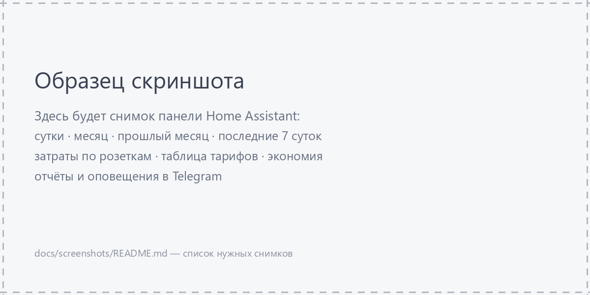

# Скриншоты панелей

Сюда складываются скриншоты дашбордов, чтобы их можно было показывать в описании
проекта и в руководстве [«С чего начать»](../GETTING_STARTED.md).

Планируемый набор (имена файлов — по содержимому, формат PNG, ширина 1200–1600 px):

| Файл | Что на нём |
| --- | --- |
| `energy-today.png` | вкладка «Текущие сутки»: расход и стоимость по T1/T2/T3, столбцы по часам, мгновенные значения |
| `energy-month.png` | вкладка «Текущий месяц»: расход с 1-го числа, столбцы по суткам |
| `energy-prev-month.png` | вкладка «Предыдущий месяц»: расход за прошлый месяц, показания на границах месяца |
| `energy-last-7-days.png` | вкладка «Предыдущие 7 суток»: столбчатый график по дням |
| `sockets-today.png` | дашборд розеток, вкладка «Сегодня»: затраты по приборам за сутки и месяц |
| `sockets-month.png` | вкладка «Месяц»: затраты и накопленная экономия, столбцы по месяцам |
| `sockets-energy.png` | вкладка «Энергия»: таблица тарифов с отметкой действующей зоны и блок «Что можно сэкономить» |
| `energy-dashboard-ha.png` | встроенная панель «Энергия» Home Assistant с разбивкой по тарифам |
| `telegram-report.png` | отчёт в Telegram: расход по зонам, затраты по приборам, график по дням месяца |
| `telegram-peak-alert.png` | оповещение о мощном приборе, включившемся в дорогой зоне T1 |

Как вставлять в документацию:

```markdown

```

Пока реальных снимков нет, в папке лежит образец `example.png` — на нём удобно
проверить, что путь и разметка верные:



Перед публикацией уберите с картинок личные данные: адреса, имена устройств,
номер лицевого счёта, координаты, токены, e-mail и всё, что не хотите показывать.
